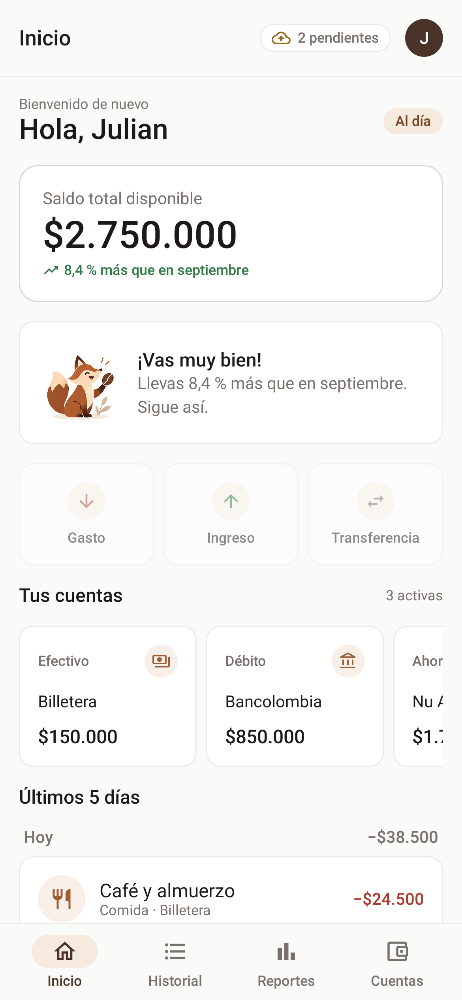
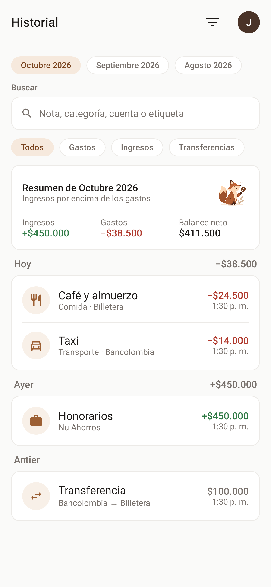
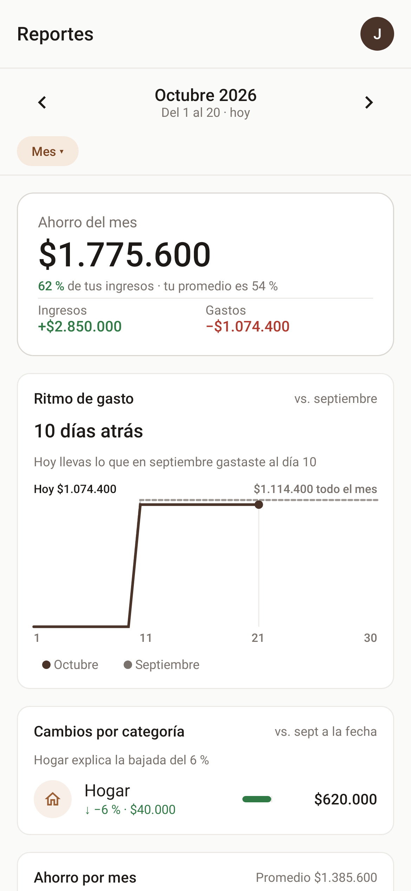
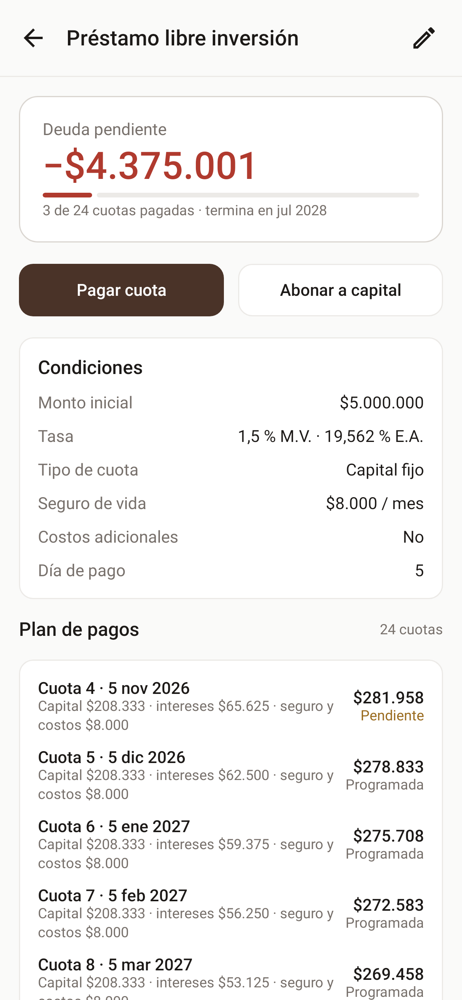

<h1 align="center">
  <picture>
    <source media="(prefers-color-scheme: dark)" srcset=".github/readme/coffer-logo-horizontal-dark.png">
    
  </picture>
</h1>

<p align="center">
  <em>Tus finanzas personales, guardadas en tu teléfono aunque no haya señal.</em>
</p>

<p align="center">
  <a href="https://github.com/Julian049/coffer-app/releases/latest"></a>
  <a href="https://github.com/Julian049/coffer-app/actions/workflows/ci.yml"></a>
  
  
  
</p>

<p align="center">
  <a href="#funciones">Funciones</a> •
  <a href="#instalar">Instalar</a> •
  <a href="#cómo-está-hecha">Cómo está hecha</a> •
  <a href="#desarrollo">Desarrollo</a> •
  <a href="#documentación">Documentación</a> •
  <a href="#licencia">Licencia</a>
</p>

<p align="center">
  
  
  
  
</p>

---

**Coffer** es una app Android de finanzas personales **offline-first**: todo funciona sin conexión sobre una base de datos cifrada en el teléfono y se respalda en la nube cuando hay red. El nombre viene de *coffer*, el cofre donde se guarda el dinero, y suena a *coffee*: un guiño a Colombia. Por eso la mascota es un zorro con un grano de café.

Este repositorio es el cliente Android. El servicio en la nube está en [coffer-server](https://github.com/Julian049/coffer-server) y toda la documentación (requisitos, arquitectura, diseño, pruebas) en [coffer-docs](https://github.com/Julian049/coffer-docs).

## Funciones

### 💸 Movimientos

- Gastos, ingresos y transferencias entre cuentas, con categorías, subcategorías y una etiqueta.
- El nombre va primero y sugiere los que ya usaste, con su categoría.
- Historial completo por mes, con búsqueda y filtros combinables.
- **Historial de cambios** de 90 días: restaura un movimiento borrado o revierte una edición.

### 🏦 Cuentas, tarjetas y préstamos

- Efectivo, ahorros, tarjetas de crédito y préstamos, cada uno con su saldo o su deuda.
- **Tarjetas de crédito:** compras a cuotas con su tasa, fecha de corte y de pago, el extracto del periodo y su pago.
- **Préstamos:** cuota fija o capital fijo, plan de pagos, pago de cuotas y abonos a capital que reducen el plazo o la cuota.
- **Saldo disponible y saldo neto:** el neto descuenta lo que vence este periodo en tarjetas y préstamos.

### 🔔 Pagos y avisos

- Gastos recurrentes con su frecuencia; los que vencen pronto aparecen en Inicio.
- Avisos diarios de pagos pendientes, con los días de anticipación que elijas.

### 📊 Reportes

- Ingresos, gastos y balance por semana, mes o rango, con evolución de 6 periodos.
- Gastos por categoría, intereses de tarjetas y préstamos, y actividad.
- Categorías excluidas de reportes y etiquetas fijadas con su total del mes.

### 🦊 Inicio a tu medida

- Un zorro que cambia según cómo van tus finanzas, y en el Historial muestra cómo cerró cada mes.
- Muestra, oculta y ordena las tarjetas de Inicio y el carrusel de cuentas.
- Montos con 0 o 2 decimales; modo claro u oscuro según el teléfono.

### ☁️ Respaldo y datos

- Base de datos cifrada con SQLCipher; la nube es una copia que se sincroniza sola.
- Inicio de sesión con usuario y contraseña o con Google.
- Importa tu historial desde Cashew (CSV) y exporta tus movimientos a CSV.

## Instalar

Coffer todavía no está en Google Play. Cada versión se publica en [Releases](https://github.com/Julian049/coffer-app/releases) con:

- `coffer-vX.Y.Z.apk`: para instalar directamente en el teléfono (Android 12 o superior).
- `coffer-vX.Y.Z.aab`: el paquete para Google Play.
- `SHA256SUMS.txt`: para comprobar que el archivo descargado no cambió.

Una versión nueva se instala encima de la anterior y conserva tus datos.

## Cómo está hecha

| Pieza | Tecnología |
| --- | --- |
| Lenguaje | Kotlin 2.4 |
| Interfaz | Jetpack Compose y Material 3, con el sistema de diseño de Coffer (paleta espresso y caramelo) |
| Navegación | Navigation Compose con rutas tipadas |
| Datos locales | Room + SQLCipher; los montos como `Long` ×10⁴, nunca `double` |
| Red | Retrofit y OkHttp con kotlinx.serialization |
| Inyección | Hilt |
| Trabajo en segundo plano | WorkManager: sincronización, avisos e importación |
| Sesión | Tokens cifrados con una llave del Android Keystore; Credential Manager para Google |

La app sigue una arquitectura por capas:

- `ui/`: pantallas y view models.
- `domain/`: modelos, casos de uso y los cálculos financieros (cuotas, tasas EA↔MV, saldos, reportes, el zorro). No depende de Android.
- `data/`: Room, sincronización, red e importación.

La sincronización empuja los cambios pendientes y trae los del servidor por lotes, con un cursor de versión, y gana el último cambio. El detalle está en `CLAUDE.md` y en el [diseño detallado](https://github.com/Julian049/coffer-docs/blob/main/03-design/detailed-design.md).

## Desarrollo

**Requisitos:** JDK 21 y el Android SDK con la API 37.

```bash
./gradlew assembleStaging                        # APK que apunta a staging
./gradlew testDebugUnitTest                      # pruebas JVM (JUnit, MockK, Robolectric, Konsist)
./gradlew recordRoborazziDebug                   # regrabar capturas tras un cambio visual
./gradlew ktlintCheck lint                       # estilo y lint
./gradlew connectedDebugAndroidTest              # pruebas instrumentadas (emulador API 31–36)
```

| Tipo de build | Servidor | Uso |
| --- | --- | --- |
| `debug` | `http://10.0.2.2:8080/` (servidor local desde el emulador) | Desarrollo |
| `staging` | `coffer-server-staging` | Probar cada PR |
| `release` | `coffer-server` | Versión publicada, firmada en CI |

La CI corre lint, ktlint, las pruebas, la verificación de capturas y el APK de staging en cada PR. Un tag `vX.Y.Z` en `main` dispara `release.yml`: pruebas instrumentadas en API 31, APK y AAB firmados y la GitHub Release. Ramas, versiones y releases siguen la [gestión de la configuración](https://github.com/Julian049/coffer-docs/blob/main/06-settings/manage-config.md). El `applicationId` (`com.dev.julian09.financeapp`) no cambia nunca.

## Documentación

| Necesitas… | Documento |
| --- | --- |
| Qué hace Coffer | [Requisitos (SRS)](https://github.com/Julian049/coffer-docs/blob/main/01-requirements/srs.md) |
| Por qué está diseñada así | [Arquitectura y ADR](https://github.com/Julian049/coffer-docs/tree/main/02-architecture) |
| Cómo funciona cada pieza | [Diseño detallado](https://github.com/Julian049/coffer-docs/blob/main/03-design/detailed-design.md) |
| El contrato con el servidor | [OpenAPI](https://github.com/Julian049/coffer-docs/blob/main/04-api/openapi.yml) |
| Cómo se prueba | [Plan de pruebas y reportes](https://github.com/Julian049/coffer-docs/tree/main/05-test) |
| Qué cambió en cada versión | [CHANGELOG](CHANGELOG.md) |

## Licencia

Código propietario: **todos los derechos reservados** (ver [`LICENSE`](LICENSE)). No se concede permiso para copiar, modificar ni distribuir el código sin autorización escrita. La marca Coffer y la mascota se generaron con ChatGPT; su uso queda reservado sin afirmar un registro. Las bibliotecas de terceros conservan sus propias licencias: [avisos de terceros](https://julian049.github.io/coffer-app/third-party-notices.html). [Política de privacidad](https://julian049.github.io/coffer-app/privacy-policy.html) · [Términos de uso](https://julian049.github.io/coffer-app/terms.html).

## Autor

[**Julian David Bocanegra Segura**](https://github.com/Julian049): producto, diseño y desarrollo.

<p align="center">
  
</p>
